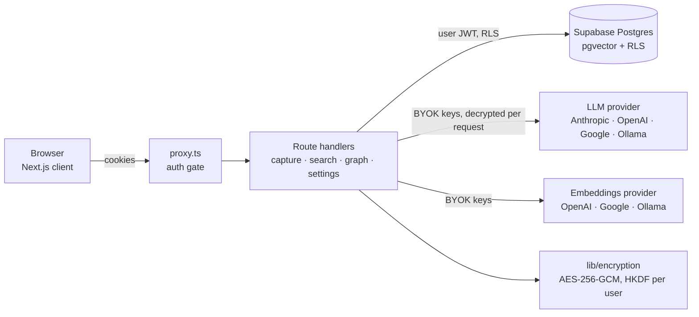

# Idea Vault

> Capture raw thoughts; an LLM turns them into structured, interlinked notes, grounded in the ideas you already have.

**Live demo:** _not deployed yet — add the URL here after the first Vercel deploy_ · **Repo:** https://github.com/CarlosEscat/idea-vault

<!-- TODO: add 2-3 screenshots or a short GIF of: capture → graph → search -->

Idea Vault is a multi-user knowledge base in the spirit of Andrej Karpathy's "LLM wiki". You write a rough note; the app
retrieves the most related notes you already have, asks a model to structure the new one and link it to those, validates
the result, and shows the whole vault as a force-directed graph.

Visitors without API keys can click **Try the demo** on the login page: a shared, read-only vault with 25 seeded ideas
(embeddings pre-computed), so the graph works immediately.

## How capture works

```
raw note ─► embed ─► pgvector top-8 similar ideas ─► 1 LLM call (structured output) ─► zod validate ─┐
              │            (keyword fallback                                        retry once ◄──────┤ invalid
              │             if no embeddings)                                                         ▼ valid
              └──────────────────────────────────────────────► drop unknown links · unique slug · save + embedding
                                                                                       │
                                                                          index.md rebuilt from the DB (no LLM)
```

- **Retrieval feeds generation.** Only the top-k related ideas (not the whole vault) are shown to the model as candidate
  connections. This is retrieval-augmented generation over the user's own notes; the model does not browse or "remember" anything.
- **One LLM call per capture.** `index.md` is generated deterministically from the database. `overview.md` is generated on demand
  (Refresh button) from a size-capped list of summaries.
- **Output is untrusted.** The reply is validated against a zod schema (category enum, length limits). On failure it is retried once
  with the validation error appended, then rejected with a clear error. Connection slugs that don't exist in the user's vault are
  dropped (and counted in the logs); slugs are made unique per user. Anthropic uses forced tool use, OpenAI/Google/Ollama use JSON mode.
- **Embeddings are computed before the note is saved**, not after the response, because serverless work after the response isn't guaranteed to run.
  Each vector records the model that produced it, and search never mixes vectors from different models.

## Architecture



Graph edges combine four signals: explicit links (0.35), pgvector semantic similarity (0.40), tag overlap (0.15) and category
affinity (0.10); explicit links always draw an edge. The weights are named constants in `lib/graph/scoring.ts`.

## Features

- Capture → structured markdown page with title, category, tags, summary, connections and suggested gaps
- Force-directed knowledge graph (D3)
- Semantic search, with an optional hybrid mode (vector + full-text on titles/tags) and similarity scores
- Bring-your-own-key LLMs (Anthropic, OpenAI, Google, Ollama) and embeddings (OpenAI, Google, Ollama)
- Stale-vector detection and re-embedding when you change embeddings model
- Idea versioning, export to `.md` files, usage summary (calls, latency, tokens, estimated cost) in Settings

## Getting started

```bash
git clone https://github.com/CarlosEscat/idea-vault && cd idea-vault
npm install
cp .env.local.example .env.local   # fill in; ENCRYPTION_SECRET: openssl rand -base64 32
```

1. Create a Supabase project and run `supabase/schema.sql`, then every file in `supabase/migrations/` (oldest first).
2. `npm run dev`, sign up, and add an LLM (and optionally an embeddings provider) in Settings.
3. Optional demo vault: `npm run seed:demo`, then set the printed `DEMO_USER_ID`.

## Deploying

**Vercel is the primary path** — see [DEPLOYMENT.md](DEPLOYMENT.md) for environment variables, Supabase redirect URLs, region
choice and function limits. `Dockerfile`, `docker-compose.yml` and `nginx.conf` remain for self-hosting on a VPS.

## Security

What it does:

- **Encrypted at rest.** Note content, summaries, vault index/overview and your provider API keys are encrypted with AES-256-GCM
  (authenticated; tampering is detected) using a per-user key derived with HKDF from `ENCRYPTION_SECRET` and the user id.
- **Row Level Security** on every table; every API route authenticates the user and scopes queries to them. An opt-in integration
  test (`npm run test:rls`) checks that one user cannot read or write another's ideas, versions, settings, vault meta or search results.
- API keys are never returned to the client (the settings UI uses a `__keep__` sentinel). Markdown is rendered without raw HTML,
  with http(s)/mailto links only and no remote images. Per-user rate limits (Postgres-backed) protect the capture, search and
  embeddings routes. User-supplied Ollama URLs are checked against private/loopback addresses at save and connect time.
- The demo account is read-only at two layers (route guards and restrictive RLS policies) and has no password.

What it does **not** do — be clear-eyed about this:

- **The server holds the key.** This is not end-to-end encryption: whoever controls the server and `ENCRYPTION_SECRET` can read your notes.
  It protects against database leaks and other tenants, not against a compromised or malicious operator.
- **Not everything is encrypted.** Embeddings (which leak meaning), titles, tags, categories, slugs and connections are stored in plaintext
  so they can be queried.
- Your notes and queries are sent to the LLM/embeddings provider you configure.

## Evaluation

`npm run eval` runs 20 fixed notes (including tiny, long, non-English and prompt-injection cases) through the capture pipeline
for every provider with a key set (`ANTHROPIC_API_KEY`, `OPENAI_API_KEY`, `GEMINI_API_KEY`, `OLLAMA_BASE_URL`) and writes
`evals/results/latest.md`: valid-JSON rate, first-try schema validity, retry recoveries, invalid-connection rate, category-enum
compliance, length compliance, latency (p50/p95) and tokens / estimated cost per capture.

| Provider | Model | Valid JSON | Schema-valid (1st try) | Invalid connections | Category in enum | p50 latency | Est. cost / capture |
|---|---|---|---|---|---|---|---|
| _not run yet_ | | | | | | | |

_Results have not been generated yet — they require API keys. Paste the table from `evals/results/latest.md` here after a run._

## Testing

```bash
npm test            # encryption round-trip + tamper detection, zod schema + slug filtering, graph scorer, retrieval
npm run test:rls    # opt-in: cross-user isolation against a real Supabase dev project (creates throwaway users)
npx tsc --noEmit && npm run lint
```

## Limitations

- Demo search is keyword-only (no embeddings key is available to visitors); the graph in the demo uses pre-computed vectors.
- The demo is a single shared account, not an isolated copy per visitor.
- Hybrid search's full-text half covers titles and tags only, because content and summaries are encrypted.
- Vectors are fixed at 768 dimensions; models that return another size are skipped (e.g. `mxbai-embed-large`, `all-minilm` on Ollama).
- Ideas embedded before the model-tracking migration have an unknown model and are excluded from search until re-embedded (Settings → Embeddings Index).
- Rate limiting is a per-user fixed window and fails open if its database function is unavailable.
- Cost figures use approximate list prices (`lib/llm/pricing.ts`) and go stale. Embedding calls don't report token counts.
- SQL migrations are applied by hand; there is no migration runner.
- No end-to-end browser tests; the mobile layout is a CSS reflow, not a redesign.

## Project structure

```
app/api/            route handlers (capture, search, graph, embeddings, overview, usage, demo, …)
lib/vault/          capture flow: retrieval, structured generation, schema/validation, index builder
lib/llm, lib/embeddings   provider abstractions (BYOK)
lib/encryption/     AES-256-GCM (+ legacy reader for pre-migration rows)
lib/graph/scoring.ts      the four-signal edge scorer
scripts/            seed-demo, migrate-encryption, check-similarity
evals/              eval harness and fixed notes
supabase/           schema.sql and migrations/
tests/              vitest suites
```

## License

MIT
